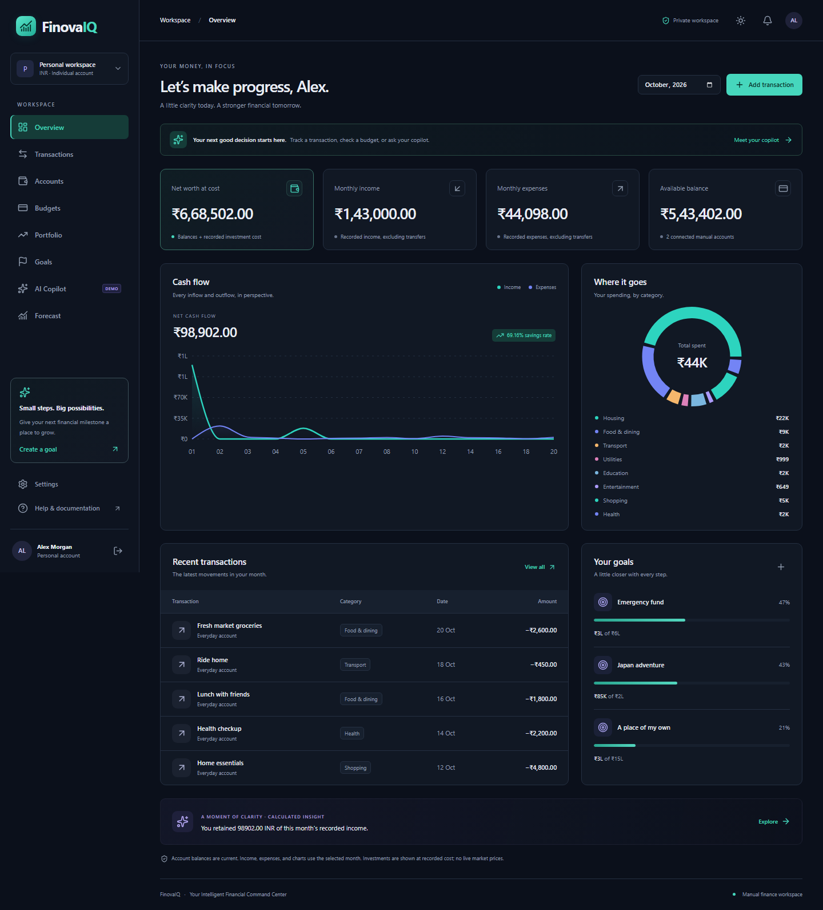

# FinovaIQ

> **Try the live demo: [Open FinovaIQ](https://finovaiq.vercel.app/)**
>
> **Email:** `demo@finovaiq.test`  
> **Password:** `FinovaDemo2026!`  
> Click **Sign in to FinovaIQ**. The password is case-sensitive.
>
> This public, shared demo contains fictional records. Do not enter personal financial information.

**Your Intelligent Financial Command Center**

A functional personal-finance workspace with an original responsive navy interface, light mode, a PostgreSQL-backed NestJS API, and an optional FastAPI/OpenAI service. The public demo is a development milestone, not a production-ready financial service. See [PROGRESS.md](PROGRESS.md) for the remaining roadmap.



## Features

- Registration, login/logout, expiring HttpOnly sessions, one-time email verification and password reset.
- Manual INR accounts, precise income/expense records, editing/deletion, search, pagination, CSV import/export and import duplicate prevention.
- Atomic account transfers excluded from income/expenses, monthly budgets and calculated over-budget insights, manually tracked savings goals.
- Multiple portfolios, buys/sells/dividends, fractional holdings, weighted-average cost and realized gains including fees; overselling prevention.
- Persisted dashboard charts, monthly filters, current balances, investment cost, category spending and goals.
- Explicit deterministic demo copilot, isolated conversation history, SSE delivery and monthly quotas. Optional server-side OpenAI adapter.
- Exact contribution-only savings scenarios, profile settings, stored notifications/read status, subscription usage and role-protected aggregate administration API.

Market prices and unrealized returns are unavailable. Seed records and DEMO-ETF are fictional. Investment trades and goal balances are separately tracked; they do not automatically debit bank accounts. Redis is provisioned but caching/workers are pending.

## Stack

pnpm 11 / Turborepo · Node 24 · Next.js 16 / React 19 / strict TypeScript · Tailwind 4 · Radix/shadcn-style button · Motion · Lucide · TanStack Query · Zustand · React Hook Form / Zod · Recharts · NestJS 11 / Swagger · Prisma 6 / PostgreSQL 17 · Python / FastAPI / OpenAI Responses API · Vitest / Testing Library / Supertest / Playwright / axe-core.

Prisma 6 is retained for the tested direct PostgreSQL client/migration workflow. Overrides patch transitive dependencies. No paid APIs are required for demo mode.

## Local development

Requires Node 24+, pnpm 11.25.0, and PostgreSQL (Docker Linux containers or the included fallback).

```powershell
pnpm install --frozen-lockfile
Copy-Item .env.example apps/api/.env
docker --context desktop-linux compose up -d postgres redis
# If Docker is unavailable, instead run in a separate terminal:
pnpm db:local
```

Do not run both database options on port 5432. Then:

```powershell
pnpm db:generate
pnpm db:migrate
pnpm db:seed
pnpm dev
```

Frontend: [localhost:3001](http://localhost:3001) (3000 was occupied by Grafana). API: [localhost:4000/api/v1/health](http://localhost:4000/api/v1/health). Docs: [localhost:4000/api/docs](http://localhost:4000/api/docs). Optional AI: [localhost:8000/health](http://localhost:8000/health).

Synthetic demo login: **demo@finovaiq.test / FinovaDemo2026!**. Local registration creates an empty workspace; hosted registration requires SMTP. Seeding preserves an existing demo account. Use the public fixture only with an isolated synthetic demo database.

## Checks

```powershell
pnpm lint
pnpm typecheck
pnpm test
$env:RUN_INTEGRATION='1'; pnpm --filter @finovaiq/api test
Remove-Item Env:RUN_INTEGRATION
pnpm build
pnpm exec playwright install chromium
pnpm test:e2e
pnpm audit --prod --audit-level high
```

Production frontend: `pnpm --filter @finovaiq/web start` after build. Start compiled API from `apps/api` with `node dist/main.js`. Python setup is optional; see SETUP.md.

## Documentation

[Architecture](ARCHITECTURE.md) · [Setup](SETUP.md) · [API](API.md) · [Database](DATABASE.md) · [Security](SECURITY.md) · [Testing](TESTING.md) · [Deployment](DEPLOYMENT.md) · [Progress](PROGRESS.md).

INR/manual accounts only. No real bank connections, paid billing, live prices, corporate actions, background jobs or production monitoring. Live AI generation currently finishes before chunked SSE delivery; tool-calling orchestration is pending. Database aggregates currently load a user's history for balances; scale/performance targets are unmeasured. Charts use numeric approximations for display; persisted money and financial calculations use BigInt/Decimal.

Repository: [FinovaIQ-AI-Personal-Finance-Investment-Dashboard](https://github.com/manikantbindass/FinovaIQ-AI-Personal-Finance-Investment-Dashboard). The original Git history is preserved. The hosted demonstration runs on Vercel with a separate synthetic PostgreSQL database.
